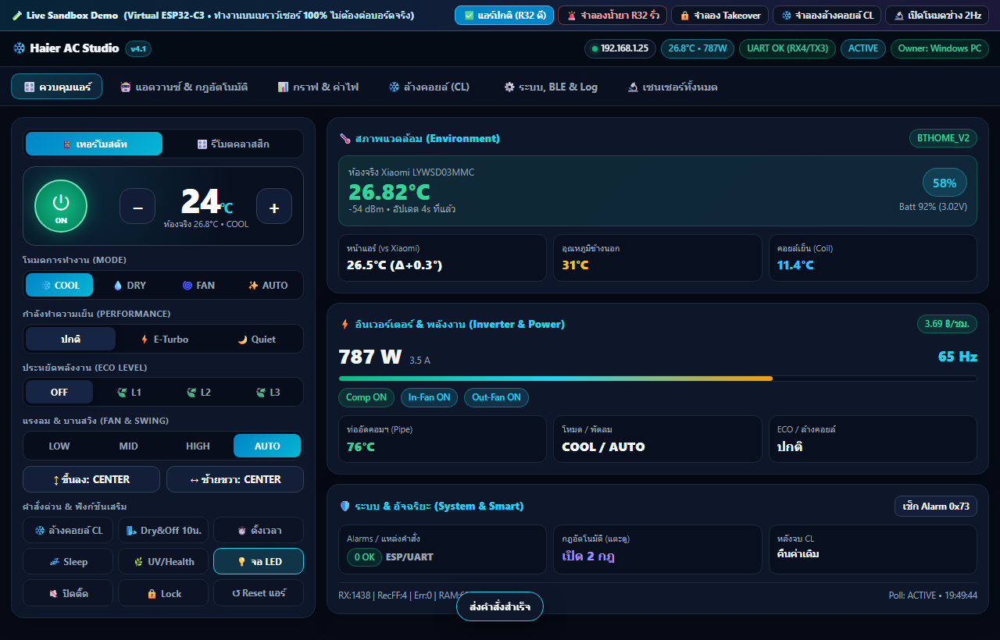
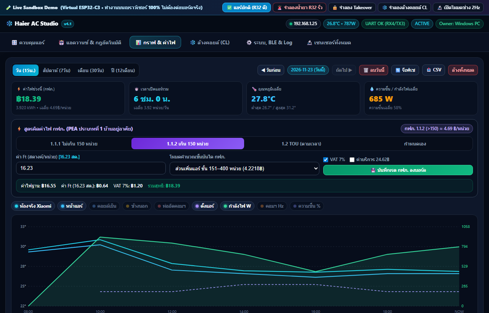
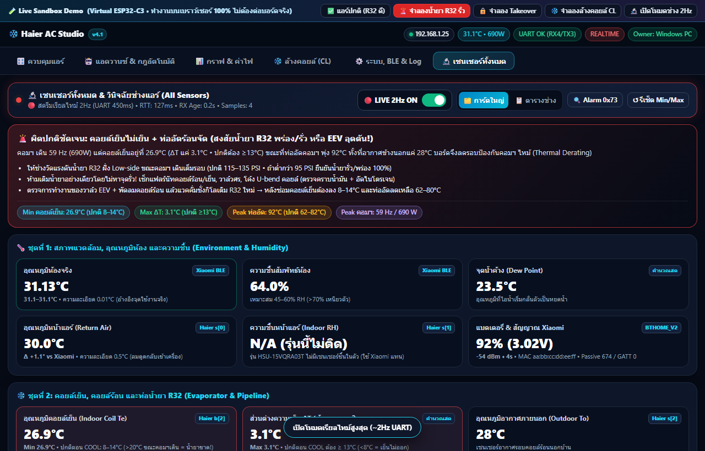
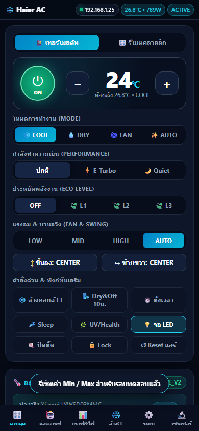
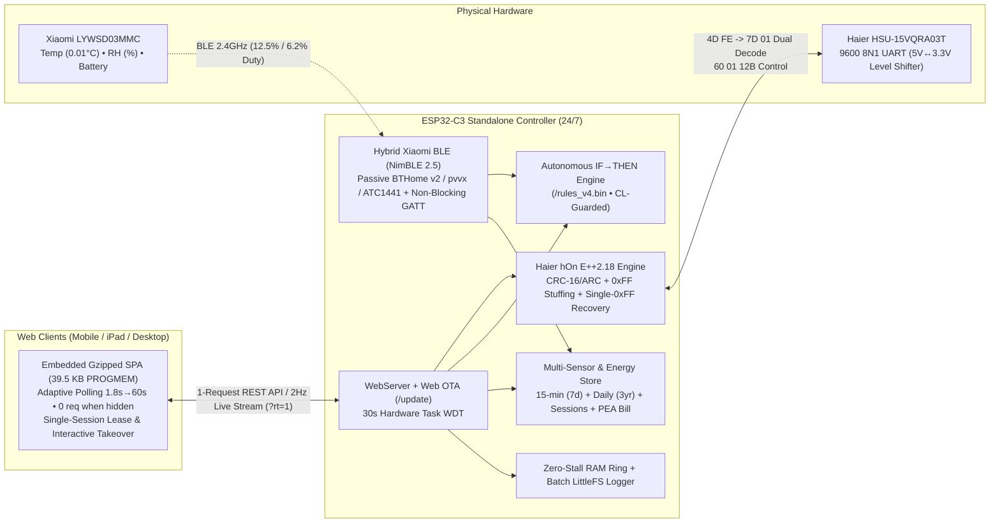

# Haier hOn ESP32-C3 Studio (`haier-hon-esp32c3-studio` v4.1) — Local UART Controller, PEA Energy Meter & Technician Diagnostics

> **TH:** ระบบควบคุมแอร์ Haier Inverter (`HSU-15VQRA03T` / โปรโตคอล `hOn E++2.18`) แบบพึ่งพาตนเอง 100% บนชิป **ESP32-C3** เชื่อมต่อผ่าน UART โดยตรง ไม่พึ่งคลาวด์ ไม่ต้องลงแอป ผสานเซนเซอร์ห้องจริง **Xiaomi LYWSD03MMC (BLE)**, ระบบคำนวณค่าไฟ **กฟภ. (PEA ประเภทที่ 1 บ้านอยู่อาศัย)**, กฎอัตโนมัติ **`IF → THEN`** ทำงานเอง 24 ชม., และหน้า **All-Sensors Real-Time 2Hz** สำหรับช่างแอร์วินิจฉัยน้ำยา R32 รั่วได้ทันที
>
> **EN:** Fully local, cloud-free smart controller for Haier Inverter Air Conditioners (`hOn E++2.18` UART protocol) built on **ESP32-C3**. Embeds a gzipped responsive Web App (`PROGMEM`), hybrid passive/GATT **Xiaomi LYWSD03MMC BLE** room climate sensing, Thailand **PEA residential electricity bill calculator** (`1.1.1` / `1.1.2` / `1.2 TOU` + Ft satang + VAT 7%), autonomous LittleFS `IF → THEN` automation rules, and a **2 Hz Real-Time All-Sensors Technician Diagnostic Dashboard**.

---

## 🎮 ทดลองเล่นหน้าเว็บจำลองสด (Interactive GitHub Pages Live Demo)

🌐 **Live Demo (GitHub Pages):** **[`https://rathanon-lab.github.io/haier-hon-esp32c3-studio/`](https://rathanon-lab.github.io/haier-hon-esp32c3-studio/)**

เปิดใช้งาน **GitHub Pages** จากโฟลเดอร์ **`/docs`** (ไฟล์ [`docs/index.html`](./docs/index.html)) เพื่อทดลองเล่นทุกเมนูบนเบราว์เซอร์ได้ทันที 100% โดยไม่ต้องต่อบอร์ดจริง — รองรับการสลับสถานการณ์จำลอง:
- **✅ แอร์ปกติ (Healthy R32):** ทดสอบปุ่มควบคุม เทอร์โมสตัท/รีโมตคลาสสิก, ตั้งเวลา, สร้างกฎ `IF → THEN`, ปรับสูตรค่าไฟ กฟภ. (`1.1.1` / `1.1.2` / `1.2 TOU` / `Ft 16.23 สต.`)
- **🚨 จำลองน้ำยา R32 รั่ว:** ดูแผงวินิจฉัยช่างแอร์แจ้งเตือนแบบเรียลไทม์เมื่อคอยล์เย็นไม่ลด (`27°C`) แต่ท่ออัดคอมฯ พุ่ง (`92°C`)
- **🔒 จำลอง Single-Session Takeover:** ทดสอบโหมด Read-Only + ป๊อปอัปยึดสิทธิ์ควบคุมข้ามเครื่อง
- **❄️ จำลองล้างคอยล์ Self-Clean (CL):** ดูสถานะ 4 เฟสและระบบเด้งกลับหน้าควบคุมอัตโนมัติเมื่อจบ

> **GitHub Pages Setup (Web Upload Friendly):**  
> อัปโหลดไฟล์ทั้งหมดในโฟลเดอร์นี้ผ่านหน้าเว็บ GitHub → ไปที่ **Settings → Pages → Branch: `main` → Folder: `/docs` → Save** จะได้หน้า Live Demo ออนไลน์ทันที!

---

## 📱 ตัวอย่างหน้าเว็บควบคุม (Responsive Web UI Preview)

| Desktop Control (Thermostat & 3 Sensor Cards) | PEA (กฟภ.) Calculator & Multi-Overlay Chart |
| :---: | :---: |
|  |  |

| All-Sensors Technician Mode & R32 Leak Alert (2 Hz) | Mobile Native App Shell (`390×844` • 6-Tab Bottom Nav) |
| :---: | :---: |
|  |  |

---

## 🏗️ สถาปัตยกรรมระบบ (System Architecture)



---

## ⚡ จุดเด่นเชิงวิศวกรรม (Engineering Highlights)

- **Haier hOn (`E++2.18`) Protocol Engine ([`haier_protocol.h`](./firmware/p25_haier_c3/haier_protocol.h)):**
  - ถอดรหัสเฟรมเดี่ยว **`4D FE → 7D 01`** (50 bytes) ได้ทั้งสถานะควบคุม + เซนเซอร์ในห้อง + BigData อินเวอร์เตอร์ (`Power W`, `Indoor Coil Te`, `Discharge Pipe Td`, `Comp Hz`, `Current A`, `EEV`, `4-Way Valve`, `Out-Fan`) ครบใน 1 UART roundtrip (`~110–170 ms`)
  - กู้เฟรมที่หัว `0xFF` ตกหล่น 1 ไบต์ได้ 100% ภายใต้การตรวจ **8-bit Checksum + CRC-16/ARC (24-bit verification)** และรองรับ byte-stuffing `0xFF → 0xFF 0x55`
- **Adaptive Dynamic Polling & Eco-Idle Sleep ([`p25_haier_c3.ino`](./firmware/p25_haier_c3/p25_haier_c3.ino)):**
  - ปรับความถี่ UART อัตโนมัติตามการใช้งานจริง: **`450 ms`** (Real-Time 2 Hz โหมดช่างแอร์), **`1.8 s`** (มีคนเปิดเว็บ), **`15 s`** (เปิดแอร์แต่ปิดเว็บ), **`60 s`** (Eco-Idle ตอนปิดแอร์ + ลด BLE scan เหลือ `6.2%`), และ **`5 s`** ล็อกเฉพาะช่วงล้างคอยล์ (CL)
  - บันทึก Log ลง RAM ทันที (`<0.05 ms`) และ Batch-Flush ลง LittleFS ทุก 25 วินาที พร้อม **Hardware Watchdog 30 วินาที**
- **Single-Session Exclusive Lease & Zero Native Dialogs:**
  - ควบคุมได้ทีละ 1 อุปกรณ์ อุปกรณ์อื่นเข้าโหมด Read-Only พร้อมป๊อปอัป **Takeover** ในหน้าเว็บ — ตัด `alert()` / `confirm()` / `prompt()` ของเบราว์เซอร์ออกทั้งหมด
- **PEA (กฟภ.) Residential Tariff Calculator:**
  - รองรับอัตรา **ประเภทที่ 1 บ้านอยู่อาศัย** ครบทั้ง `1.1.1` (≤150 หน่วย, ขั้นบันได 7 ขั้น, ค่าบริการ `8.19฿`), `1.1.2` (>150 หน่วย, ขั้นบันได 3 ขั้น, ค่าบริการ `24.62฿`), `1.2 TOU` (On-Peak/Off-Peak ตามวัน-เวลาจริง), ปรับ **ค่า Ft (สตางค์/หน่วย)** และ **VAT 7%** ได้สด ๆ พร้อมกราฟ Multi-Overlay 2 แกน, Heatmap 24 ชม., ลบข้อมูลแยกวัน และ Export CSV
- **All-Sensors Technician Mode (`🔬 เซนเซอร์ทั้งหมด`):**
  - สตรีมสดความเร็วสูงสุด (~2 Hz), แสดงครบ 25 พารามิเตอร์ แบ่ง 4 หมวด (สลับได้ทั้งการ์ดใหญ่และตารางช่าง), เก็บค่า `Min Coil` / `Max ΔT` / `Peak Pipe` / `Peak W-Hz`, และ **วิเคราะห์อาการน้ำยา R32 พร่อง/รั่ว (Low ΔT + High Discharge Pipe Thermal Derating)** ให้อัตโนมัติ

---

## 🔌 การต่อวงจรฮาร์ดแวร์ (Hardware Pinout)

| ขา ESP32-C3 | ผ่าน Level Shifter (3.3V ↔ 5V) | พอร์ต Wi-Fi UART ของแอร์ Haier (`CN` 4-Pin) |
| :--- | :--- | :--- |
| **GPIO 4 (RX)** | LV1 ↔ HV1 | **AC TX (รับข้อมูลจากบอร์ดแอร์)** |
| **GPIO 3 (TX)** | LV2 ↔ HV2 | **AC RX (ส่งคำสั่งเข้าบอร์ดแอร์)** |
| **3.3V / 5V** | LV / HV Power | **+5V DC** (จ่ายผ่าน Buck/LDO พร้อม C กรองไฟ) |
| **GND** | Common GND | **GND ร่วม** |

> [!CAUTION]
> พอร์ต UART บนบอร์ดแอร์ Haier ใช้ระดับแรงดัน **5V TTL** ต้องต่อผ่าน **Bi-Directional Logic Level Shifter (5V ↔ 3.3V)** เสมอ ห้ามต่อ 5V เข้าขา GPIO ของ ESP32-C3 โดยตรง

---

## 🚀 การคอมไพล์และอัปเดตเฟิร์มแวร์ (Quick Start)

1. แก้ค่า Wi-Fi / BLE MAC / OTA Password ใน [`firmware/p25_haier_c3/p25_haier_c3.ino`](./firmware/p25_haier_c3/p25_haier_c3.ino) (ดูตัวอย่างใน [`.env.example`](./.env.example)) หรือบูตเข้า Fail-Safe Hotspot `Haier-AC-P25-AP` (`192.168.4.1`) เพื่อตั้งค่าผ่านเว็บได้เลย
2. แพ็กหน้าเว็บ, คอมไพล์ และส่งอัปเดตแบบไร้สายผ่าน Web OTA:
```bash
python firmware/p25_haier_c3/pack_ui.py
arduino-cli compile --fqbn "esp32:esp32:esp32c3:CDCOnBoot=cdc,PartitionScheme=min_spiffs" --export-binaries firmware/p25_haier_c3
python firmware/ota_flash.py 192.168.1.25
```
3. ทดสอบ Unit Tests ของ Protocol Codec & Self-Clean State Machine (PC Studio):
```bash
python -m unittest pc_studio/tests/test_haier_studio.py -v
```

---

## 📚 Protocol Reference & Acknowledgements

- **Haier hOn (`E++2.18`) UART Protocol:** Frame structure, control byte layout, and Self-Clean register references adapted from open-source **ESPHome Haier (`hOn` / `hon_climate.cpp`)** community documentation ([esphome/esphome](https://github.com/esphome/esphome), [paveldn/haier-esphome](https://github.com/paveldn/haier-esphome)).
- **Xiaomi LYWSD03MMC BLE Formats:** Passive advertisement decoding supports open community formats (`BTHome v2`, `pvvx`, `ATC1441`).
- Released under the [MIT License](./LICENSE).
